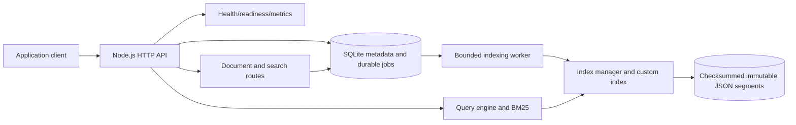

# SearchCraft

SearchCraft is a lightweight, self-contained search indexing and query service written in strict TypeScript. It is designed as a portfolio-grade backend system that makes search-engine mechanics and operational tradeoffs visible rather than delegating them to OpenSearch or Elasticsearch.

> **Current status:** Phase 8 advanced search and storage features complete. The service exposes operational endpoints, named indexes, durable source documents, bounded NDJSON bulk actions, exact/sloppy phrase queries, VByte-compressed posting positions, bounded prefix term-dictionary blocks, online generation reindexing, validated snapshot archives, a custom Unicode-aware inverted index, global BM25 ranking across segments, filters, cursor pagination, a bounded SQLite job queue, batched worker publication, restart recovery, checksummed segment publication, and background compaction.

## Why this project exists

SearchCraft is built around the engineering questions behind a real search service:

- How are text fields tokenized deterministically?
- How do terms map to posting lists?
- How does BM25 rank candidates using term statistics and field boosts?
- How can document updates and deletes remain correct while indexing is asynchronous?
- How can immutable segments be merged and published without exposing partial state?
- How do durable jobs recover after a process or filesystem failure?
- How can resource consumption remain predictable on a small development machine?

The implementation will favor correctness, explicit consistency semantics, bounded memory, measurable behavior, and recoverable operations over premature distributed complexity.

## Current feature status

| Capability                                             | Status                               |
| ------------------------------------------------------ | ------------------------------------ |
| Native Node.js HTTP server                             | Implemented                          |
| Strict TypeScript project and reproducible npm scripts | Implemented                          |
| SQLite initialization and explicit migration tracking  | Implemented                          |
| Health and readiness endpoints                         | Implemented                          |
| JSON and Prometheus-compatible process metrics         | Implemented                          |
| OpenAPI endpoint and checked-in specification          | Implemented for foundation endpoints |
| Structured JSON logging and request IDs                | Implemented                          |
| Named indexes and document ingestion                   | Implemented asynchronously           |
| Custom inverted index and tokenizer                    | Implemented                          |
| BM25 ranking                                           | Implemented                          |
| Durable asynchronous indexing worker                   | Implemented                          |
| Filters and cursor pagination                          | Implemented                          |
| Immutable segments and compaction                      | Implemented in Phase 4               |
| Streaming NDJSON bulk ingestion and batch metrics      | Implemented in Phase 5               |
| Online reindexing and generation swaps                 | Implemented in Phase 6               |
| Snapshot archives and restore tooling                  | Implemented in Phase 6               |
| Reproducible workload benchmark and CI                 | Implemented in Phase 7               |
| Phrase queries and index compression                   | Implemented in Phase 8               |

## Architecture

The initial runtime is one Node.js process with a local SQLite database and configurable disk-backed runtime data. The final modular monolith will keep HTTP handling, durable source state, indexing, querying, maintenance, and observability separate without introducing microservices.



More diagrams and architecture decisions are in [`docs/architecture/ARCHITECTURE.md`](docs/architecture/ARCHITECTURE.md), [`docs/architecture/diagrams/`](docs/architecture/diagrams/), and [`docs/decisions/`](docs/decisions/).

## Hardware-conscious design

The baseline deliberately avoids OpenSearch, PostgreSQL servers, Docker dependencies, Redis, and local embedding models. On an 8 GB M1 MacBook Air, this means the development process is primarily one Node.js process plus files on disk.

Resource safeguards are part of the design:

- One indexing worker initially.
- Configurable request-body, query, and bulk limits.
- Bounded metric samples rather than unbounded latency history.
- SQLite WAL mode for local durable metadata.
- Immutable segments and staged publication rather than rewriting one monolithic index file.
- Runtime data, snapshots, and generated benchmark data excluded from Git.
- Benchmark profiles will be selected from measurements rather than assumed capacity.

The first custom index will be intended for small and medium local datasets. It is not yet claiming OpenSearch-scale throughput or storage efficiency.

## Prerequisites

- Node.js 22.x
- npm 10.x
- Git

The current implementation uses Node's built-in `node:sqlite`. Verify it with:

```bash
node --no-warnings -e "const { DatabaseSync } = require('node:sqlite'); const db = new DatabaseSync(':memory:'); db.exec('select 1'); console.log('node:sqlite available'); db.close();"
```

No Docker, PostgreSQL server, or external service is required for local development.

## Setup

```bash
npm install
npm run db:migrate
```

The default runtime directory is `./data`. It contains the SQLite database and, as later phases are implemented, index generations, staging data, and snapshots. Configure paths and safeguards with environment variables; see [`.env.example`](.env.example).

## Run SearchCraft

```bash
npm run build
npm start
```

For a rebuild-then-watch development loop:

```bash
npm run dev
```

The server listens on `127.0.0.1:3000` by default.

Try the implemented endpoints:

```bash
curl -i http://127.0.0.1:3000/health
curl -i http://127.0.0.1:3000/ready
curl -s http://127.0.0.1:3000/metrics | jq
curl -s http://127.0.0.1:3000/metrics/prometheus
curl -s http://127.0.0.1:3000/openapi.json | jq
```

Create an index, index documents, and search them:

```bash
curl -sS -X POST http://127.0.0.1:3000/v1/indexes \
  -H 'content-type: application/json' \
  -d '{"name":"products","config":{"searchableFields":{"title":{"boost":2},"description":{"boost":1}},"storedFields":["title","description"]}}'

curl -sS -X PUT http://127.0.0.1:3000/v1/indexes/products/documents/product-123 \
  -H 'content-type: application/json' \
  -d '{"fields":{"title":"MacBook Air M1","description":"Lightweight laptop with excellent battery life"}}'

curl -sS 'http://127.0.0.1:3000/v1/indexes/products/search?q=battery&limit=20' | jq
```

Production writes return `202 Accepted` after the source document and indexing job commit in SQLite. `searchVisible: false` means the worker has not necessarily published the document yet; poll the returned job or `/status`. Queue saturation returns `429` with `Retry-After: 1` and does not commit the rejected mutation.

Bulk writes use bounded, atomic NDJSON batches. `index`, `create`, and `update` actions are followed by a source line; `delete` actions are metadata-only:

```bash
curl -sS -X POST http://127.0.0.1:3000/v1/indexes/products/documents/_bulk \
  -H 'content-type: application/x-ndjson' \
  --data-binary $'{"index":{"_id":"product-123"}}\n{"fields":{"title":"MacBook Air M1"}}\n{"delete":{"_id":"old-product"}}\n'
```

Bulk source mutations and their indexing jobs commit in one SQLite transaction. The request is rejected without partial writes when the NDJSON is invalid, the batch exceeds configured limits, a `create` conflicts, an `update` target is missing, or the bounded queue cannot admit the complete batch. Production bulk requests return `202` with one job ID per accepted action; the worker claims bounded batches and publishes one multi-document segment per index.

Start an online rebuild from the durable SQLite source and poll its status without interrupting reads:

```bash
curl -sS -X POST http://127.0.0.1:3000/v1/indexes/products/documents/_reindex | jq
curl -sS http://127.0.0.1:3000/v1/indexes/products/documents/_reindex/<job-id> | jq
```

Create and restore a validated point-in-time archive with the snapshot commands. Stop the service before restoring:

```bash
npm run snapshot:create -- --output ./data/snapshots/searchcraft.snapshot.gz
# Stop SearchCraft before restoring.
npm run snapshot:restore -- --archive ./data/snapshots/searchcraft.snapshot.gz
```

## Quality checks

```bash
npm run typecheck
npm run lint
npm run format:check
npm test
npm run docs:check
npm run build
```

The current benchmark measures synchronous bulk indexing throughput across batch sizes and BM25 search latency at p50, p95, and p99:

```bash
npm run benchmark
SEARCHCRAFT_BENCHMARK_DOCUMENTS=1000 SEARCHCRAFT_BENCHMARK_BATCH_SIZES=10,100 npm run benchmark
```

See [`docs/development/BENCHMARKING.md`](docs/development/BENCHMARKING.md) for workload controls and interpretation limits. Results are local, sequential, and machine-dependent.

## Persistence and consistency direction

The ingestion flow persists a source-document mutation and its indexing job in one SQLite transaction, then lets a bounded worker publish the current index snapshot asynchronously. A successful document write means **durably accepted**, not immediately searchable. Job and index status endpoints expose the eventual-consistency boundary.

SQLite and filesystem writes cannot share one atomic transaction. Segment files are staged, checksum-validated, atomically renamed, and published through a manifest that swaps the complete active segment list. Readers resolve document versions and tombstones before computing global BM25 statistics; a stale job must never overwrite a newer document version.

## Documentation map

- [Project plan](docs/PROJECT_PLAN.md)
- [Architecture overview](docs/architecture/ARCHITECTURE.md)
- [Development setup](docs/development/SETUP.md)
- [Testing](docs/development/TESTING.md)
- [Lightweight architecture ADR](docs/decisions/ADR-0001-lightweight-architecture.md)
- [OpenAPI 3.1 document](docs/api/openapi.json)
- [Operational runbook](docs/operations/RUNBOOK.md)
- [Mermaid diagrams](docs/architecture/diagrams/)

## Known limitations

- JSON segments remain inspectable, though posting positions are VByte-compressed and term metadata is organized into bounded dictionary blocks.
- The current metrics registry is process-local and intentionally lightweight.
- The current benchmark does not represent concurrent production traffic or remote-client behavior.
- There is no authentication, multitenancy, or distributed rate limiting.
- The project is marked `UNLICENSED` until a license decision is made.

## Roadmap

The implementation roadmap and acceptance criteria are maintained in [`docs/PROJECT_PLAN.md`](docs/PROJECT_PLAN.md). Each phase is expected to finish with working code, tests, documentation, diagrams, checks, and a focused Git commit.

## Contributing

See [`CONTRIBUTING.md`](CONTRIBUTING.md) for the development workflow and commit expectations. Runtime state must not be committed. Architectural changes should include an ADR and synchronized documentation.
