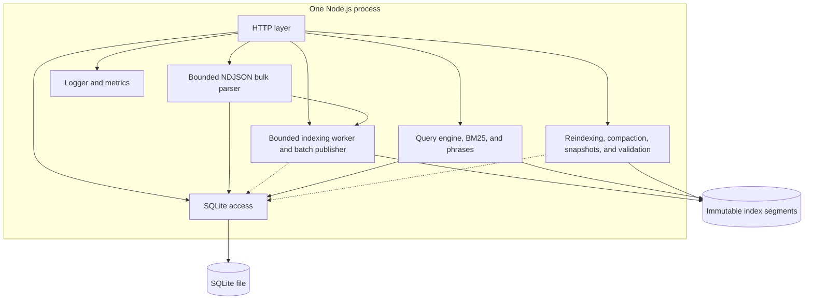
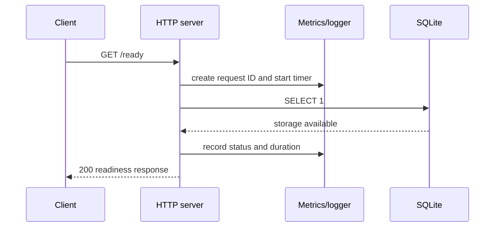

# SearchCraft Architecture

## Scope of this document

This document describes the implemented Phase 8 versioned immutable-segment indexing service. Phases 0–3 established the runtime, durable asynchronous jobs, filters, field boosts, and cursor pagination; Phase 4 adds checksummed multi-segment publication, cross-segment version resolution, and background compaction; Phase 5 adds bounded NDJSON bulk ingestion, atomic batch transactions, batched worker publication, and ingestion metrics; Phase 6 adds online target-generation reindexing, atomic swaps, and validated snapshot archives; Phase 7 adds reproducible workload measurement and CI checks; Phase 8 adds phrase matching, compressed positions, and term-dictionary blocks. Future functionality is labelled explicitly; diagrams must be updated when planned boundaries become real behavior.

## Runtime model

SearchCraft is a modular monolith. One Node.js process currently owns the HTTP server, SQLite connection, metrics registry, and structured logger. The indexing worker is a bounded worker loop in the same process initially. A separate worker process is a later deployment option only if measurements justify it.

## Responsibilities

### HTTP API

The HTTP layer owns request IDs, route matching, request limits, status codes, JSON serialization, and error envelopes. Search algorithms and SQL statements do not belong in route handlers.

Implemented routes include `/health`, `/ready`, `/metrics`, `/metrics/prometheus`, `/openapi.json`, named index management, document CRUD, `POST /v1/indexes/{index}/documents/_bulk`, online reindex start/status routes, and BM25 search. Bulk requests use a bounded streaming NDJSON parser and conventional two-line action/source records; all source mutations and jobs in one request commit atomically.

### Storage

The storage boundary owns SQLite initialization, explicit migrations, WAL setup, and future repositories for indexes, source documents, jobs, and metadata. SQLite is not the inverted index; it is the durable control plane and source-of-truth store.

### Indexing engine

The indexing boundary owns Unicode tokenization, field-aware posting construction, term frequencies, positions, global BM25 statistics, checksummed immutable segment publication, and version/tombstone resolution across active segments. Compaction merges the resolved live view into a new segment and atomically swaps the manifest without exposing a partial file list to readers.

### Query engine

The query boundary owns query tokenization, term lookup, candidate retrieval, BM25 scoring, configured exact/range filters, stable ordering, and cursor pagination. It receives an index-generation reader rather than opening HTTP or SQLite connections itself.

### Maintenance

The maintenance boundary owns segment validation, background reindexing, generation swaps, compaction, snapshot archives, staging cleanup, and safe publication. It must keep the currently active segment list usable when a merge, reindex, or validation step fails.

### Observability

The current logger writes structured JSON to stdout or stderr. The current metrics registry stores bounded histogram samples and exposes JSON and Prometheus-compatible text. Future indexing and query modules should report counters and gauges through this boundary instead of creating independent registries.

## Foundation request flow

The production document flow validates the request, commits the source mutation and indexing job in one SQLite transaction, and returns `202 Accepted`. The bounded worker claims jobs in batches, checks the latest document versions, appends one checksummed immutable segment per index batch, and marks jobs complete after manifest publication. Online reindexing builds a complete target segment from SQLite, validates it, and swaps the manifest and in-memory reader only after preparation succeeds. Search visibility is therefore eventually consistent and observable through job/status endpoints. Bulk request count, accepted document count, and bounded request-latency histograms use the shared metrics registry.

## Persistence boundaries

The initial migration creates:

- `schema_migrations` for explicit migration tracking.
- `indexes` for named-index metadata and active generation state.
- `documents` for the latest durable source document version and tombstone state.
- `indexing_jobs` for durable upsert/delete work and retry metadata; one bulk request creates one job per document action in the same transaction.

The search index lives below the configured data directory in a named index directory with a checksummed manifest and immutable JSON segments. SQLite and filesystem operations cannot share one transaction. A corrupt or incomplete active segment list falls back to a rebuild from durable source documents; successful indexing appends a new segment and atomically publishes the complete active list. Snapshot archives contain a SQLite `VACUUM INTO` copy plus the active manifest and segment files.

## Resource model

The service uses:

- One indexing worker by default.
- Bounded queue claims and batches.
- Maximum request, query, token, and result limits.
- Immutable segments instead of a repeatedly rewritten monolithic index.
- Explicit cleanup for staging directories, retired generations, and old job history.
- A configurable maximum outstanding job count per index.
- Processing leases and startup recovery for jobs left in `processing`.

No capacity or latency claim is made until the benchmark harness measures a defined workload.

## Current failure behavior

- If SQLite cannot be opened or migrated, startup fails rather than serving a false ready state.
- If readiness cannot execute a local storage probe, `/ready` returns `503`.
- Unknown routes return a consistent JSON `404` error.
- Invalid request limits produce a safe JSON error without stack traces.
- The server handles SIGINT and SIGTERM by stopping new connections, closing the HTTP server, and closing SQLite.

Job recovery, stale-version handling, queue saturation, and retry behavior are documented in [FAILURE_MODES.md](FAILURE_MODES.md). Corrupt segments are rejected by checksum and structural validation, while interrupted compaction leaves the previous manifest usable. Index generations and zero-downtime generation swaps remain later work.

## Technology tradeoffs

The decisions and revisit triggers are recorded in [ADR-0001](../decisions/ADR-0001-lightweight-architecture.md). In short, native Node.js and SQLite reduce setup and memory cost, while the custom index preserves the project's search-engine learning and portfolio value.
