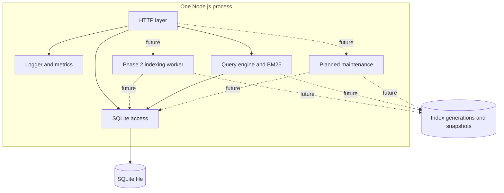
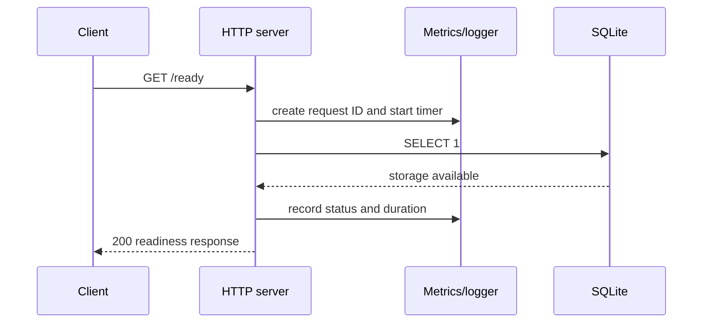

# SearchCraft Architecture

## Scope of this document

This document describes the implemented Phase 1 searchable vertical slice and the stable boundaries that later indexing phases will fill in. Future functionality is labelled explicitly; diagrams must be updated when planned boundaries become real behavior.

## Runtime model

SearchCraft is a modular monolith. One Node.js process currently owns the HTTP server, SQLite connection, metrics registry, and structured logger. The planned indexing worker is a bounded worker loop in the same process initially. A separate worker process is a later deployment option only if measurements justify it.

## Responsibilities

### HTTP API

The HTTP layer owns request IDs, route matching, request limits, status codes, JSON serialization, and error envelopes. Search algorithms and SQL statements do not belong in route handlers.

Implemented routes include `/health`, `/ready`, `/metrics`, `/metrics/prometheus`, `/openapi.json`, named index management, document CRUD, and BM25 search. Job, bulk, filter, and maintenance routes will be added only with backing functionality.

### Storage

The storage boundary owns SQLite initialization, explicit migrations, WAL setup, and future repositories for indexes, source documents, jobs, and metadata. SQLite is not the inverted index; it is the durable control plane and source-of-truth store.

### Indexing engine

The current indexing boundary owns Unicode tokenization, field-aware posting construction, term frequencies, positions, BM25 statistics, and versioned JSON snapshot publication. Later phases will add multiple immutable segments and compaction so readers are independent of in-progress writes.

### Query engine

The query boundary owns query tokenization, term lookup, candidate retrieval, BM25 scoring, stable ordering, and cursor pagination. Filters are a later phase. It receives an index-generation reader rather than opening HTTP or SQLite connections itself.

### Maintenance

The planned maintenance boundary owns reindexing, snapshots, staging cleanup, generation validation, and safe publication. It must keep the currently active generation usable when a build fails.

### Observability

The current logger writes structured JSON to stdout or stderr. The current metrics registry stores bounded histogram samples and exposes JSON and Prometheus-compatible text. Future indexing and query modules should report counters and gauges through this boundary instead of creating independent registries.

## Foundation request flow

The current Phase 1 document flow persists a source mutation in SQLite, updates the in-process custom index, and atomically publishes a JSON snapshot before returning `200` with `searchVisible: true`. Phase 2 will store a durable indexing job in the same SQLite transaction and return `202 Accepted`.

## Persistence boundaries

The initial migration creates:

- `schema_migrations` for explicit migration tracking.
- `indexes` for named-index metadata and active generation state.
- `documents` for the latest durable source document version and tombstone state.
- `indexing_jobs` for durable upsert/delete work and retry metadata.

The current search index lives below the configured data directory in a named index directory with a manifest and versioned JSON snapshots. SQLite and filesystem operations cannot share one transaction. The current implementation uses source-document rebuild recovery; later immutable segments, validation metadata, compaction, and durable job replay will make that boundary more efficient and explicit.

## Resource model

The foundation has no background worker and stores only bounded metric samples. The later system will use:

- One indexing worker by default.
- Bounded queue claims and batches.
- Maximum request, query, token, and result limits.
- Immutable segments instead of a repeatedly rewritten monolithic index.
- Explicit cleanup for staging directories, retired generations, and old job history.

No capacity or latency claim is made until the benchmark harness measures a defined workload.

## Current failure behavior

- If SQLite cannot be opened or migrated, startup fails rather than serving a false ready state.
- If readiness cannot execute a local storage probe, `/ready` returns `503`.
- Unknown routes return a consistent JSON `404` error.
- Invalid request limits produce a safe JSON error without stack traces.
- The server handles SIGINT and SIGTERM by stopping new connections, closing the HTTP server, and closing SQLite.

Later failure-mode documentation will cover job recovery, stale versions, corrupt segments, interrupted compaction, and generation swaps.

## Technology tradeoffs

The decisions and revisit triggers are recorded in [ADR-0001](../decisions/ADR-0001-lightweight-architecture.md). In short, native Node.js and SQLite reduce setup and memory cost, while the custom index preserves the project's search-engine learning and portfolio value.
